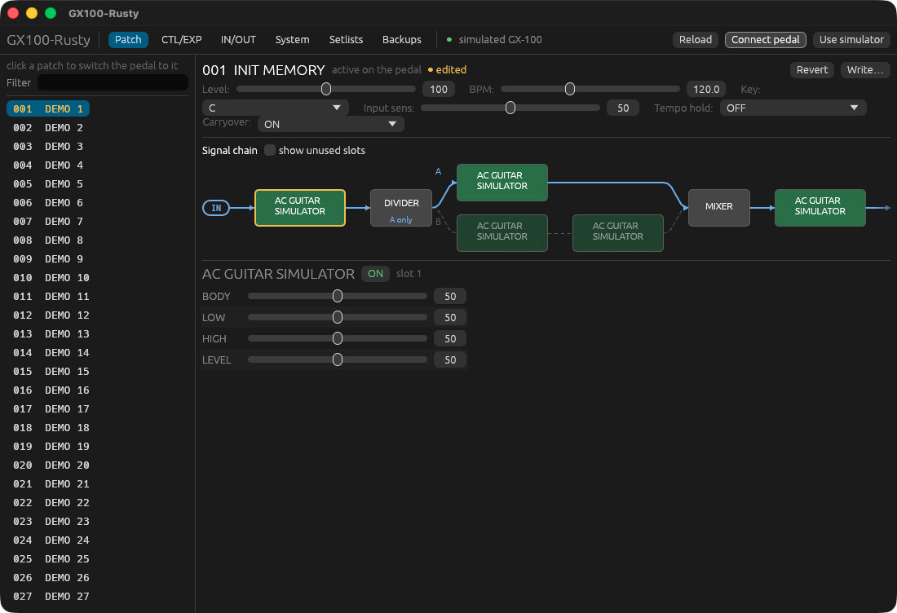
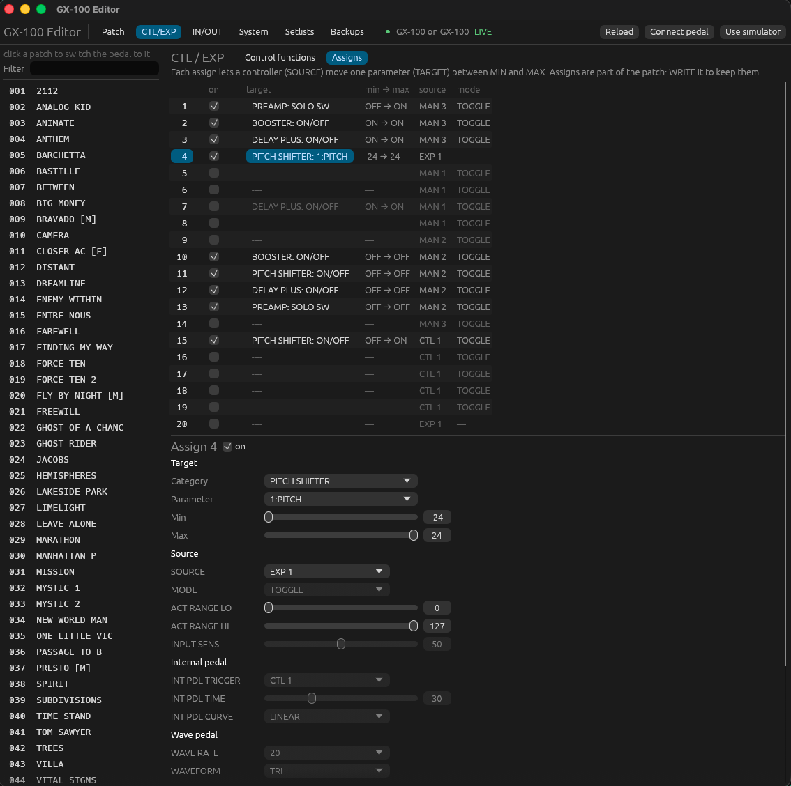

# GX100-Rusty

An independent, open-source editor for the **BOSS GX-100** guitar effects processor, written in Rust. It talks to the
pedal over USB MIDI, edits patches live, and adds things the official editor doesn't have: setlists that reorder
patches on the pedal, a byte-exact backup format compatible with BOSS TONE STUDIO, and a live view of what the pedal is
doing.

> **Not affiliated with Roland or BOSS.** "BOSS", "GX-100" and "BOSS TONE STUDIO" are trademarks of Roland
> Corporation. This repository contains **no code, data or text from Roland**: you generate the parameter tables
> from your own installed copy of BOSS TONE STUDIO (see [Getting started](#getting-started)).



## Features

- **Live patch editor**: always shows the patch active on the pedal and follows patch changes, footswitches and the
  expression pedal (values the pedal changes flash amber). Every patch setting, FX on/off and FX parameter is editable
  and written immediately. The signal chain is drawn with its parallel branch (DIVIDER → A/B → MIXER).
- **WRITE / Revert**: store the live patch into any slot (warns before replacing another patch), or drop unsaved edits.
- **CTL/EXP**: per-control functions (patch or system), and the patch's **20 assigns** with a full editor (target,
  min/max in the target's units, source, mode, act range, internal/wave pedal, MIDI CC/PC) and a live "now" column.
- **IN/OUT and System** settings: input setting presets, output select, Global EQ, play options, MIDI, USB audio.
- **Setlists**: ordered lists of patches, drag to reorder, preview what gets overwritten, then write them to the pedal
  in one go (every patch is read back and compared).
- **Backups**: full backup of the system settings and all 200 patches; reads BOSS TONE STUDIO `.alb` backups too.
- **Descriptions** (optional): parameter, option and effect explanations from Roland's online parameter guide, fetched
  on your machine.
- **Command-line tool** (`gx100`) and an in-memory **simulated pedal** for trying everything without hardware.



## Status

Early but usable. Tested on macOS with a GX-100 and BOSS TONE STUDIO 2.0.1. Windows and Linux should work in principle
(the MIDI layer is `midir`, the GUI `egui`), but the table extractor's default path is the macOS one and nobody has
tried them yet: reports welcome.

Reading is safe. Writes follow exactly what the official editor sends, and every kind of write has been verified on a
real pedal with writes that change nothing (`gx100 write-check`). Still, **make a backup first** (Backups tab).

## Getting started

You need:

- [Rust](https://rustup.rs) 1.95 or newer
- [Node.js](https://nodejs.org) 18 or newer (only to generate the tables)
- **BOSS TONE STUDIO for GX-100**, installed (free from boss.info). The editor needs the parameter tables inside it.

```sh
git clone https://github.com/lucasbossle/GX100-Rusty.git
cd GX100-Rusty

# 1. Generate the parameter tables from your BOSS TONE STUDIO install → extracted/ (gitignored)
node tools/extract/extract.mjs
#    elsewhere installed?  node tools/extract/extract.mjs "/path/to/BOSS TONE STUDIO for GX-100.app"

# 2. Optional: download the parameter guide for the descriptions (also into extracted/)
node tools/extract/manual.mjs

# 3. Run the editor (quit BOSS TONE STUDIO first: only one editor can talk to the pedal)
cargo run --release -p gx100-gui
cargo run --release -p gx100-gui -- --sim      # or try it with the simulated pedal
```

Without step 1 everything still builds, against a tiny **synthetic** table set (a warning says so). That's what the
tests use, but it is useless with a real pedal. Re-run step 1 after updating BOSS TONE STUDIO.

## Command-line tool

```
cargo run -p gx100-cli -- <command>            # add --sim to use the simulated pedal

  ports | identify | hello                     find and greet the pedal (read-only)
  patch [<n>]                                  dump a stored patch (or the live one): chain, parameters, assigns
  slots | fx-get <slot>                        the live patch's FX slots / one slot's parameters
  get <path|address> [size]                    read a parameter or raw bytes
  set <path> <value>                           write a live-patch parameter (--allow-system for system settings)
  fx-set <slot> <param> <value>                e.g. fx-set 3 drive 80
  monitor [<seconds>]                          print what the pedal sends by itself
  write-check                                  verify every write path with writes that change nothing
  find <text> | fx-types [<type>] | commands   search the tables (offline)
```

Quit the GUI before using the CLI on the pedal: both switch the pedal's editor mode.

## How it works

BOSS TONE STUDIO is a web app (HTML/JavaScript) in a native shell. `tools/extract/extract.mjs` loads its
configuration files in a sandbox and writes the address map, FX types, value labels and assign targets to
`extracted/`, then `gen_rust.mjs` turns them into `extracted/tables.rs`, which the protocol crate compiles in.
Behaviour (which messages to send, in which order) was learned by reading that app's code and confirmed on the pedal;
the code in this repository is our own.

| Path | What |
|---|---|
| `crates/gx100-protocol` | Dependency-free library: SysEx DT1/RQ1, addresses, value encodings, generated tables, `Device` session, patches, assigns, librarian, backups, simulated pedal |
| `crates/gx100-midi` | MIDI transport (`midir`) |
| `crates/gx100-cli` | `gx100` command-line tool |
| `crates/gx100-gui` | `gx100-editor`, the desktop editor (`eframe`/`egui`) |
| `tools/extract` | Table extractor, Rust generator, parameter-guide fetcher |
| `crates/gx100-protocol/fixtures` | Synthetic tables for tests and CI |
| `CLAUDE.md` | Detailed development notes: protocol facts, verification status, open items |

Settings and data live in `~/Library/Application Support/gx100-editor/` (setlists, backups) on macOS, or the
platform's equivalent data directory.

## Protocol notes

A short reference; `CLAUDE.md` has the details.

Roland SysEx over USB MIDI. Device ID `10` (the pedal reports its own in the identity reply), model ID `00 00 00 00 0B`,
4-byte addresses and sizes.

```
DT1 (write):  F0 41 10 00 00 00 00 0B 12 <addr:4> <data…>  <sum> F7
RQ1 (read):   F0 41 10 00 00 00 00 0B 11 <addr:4> <size:4> <sum> F7   → device replies with DT1(s)
sum = (128 - (Σ addr+data bytes) % 128) & 0x7F
Identity:     F0 7E 7F 06 01 F7   → reply F0 7E <dev> 06 02 41 0B 04 <num:2> <rev:4> F7
```

- **Addresses** are four 7-bit bytes. To add offsets, convert to linear (`(a<<21)|(b<<14)|(c<<7)|d`), add, convert back.
- **Encodings:** `INTEGER1x7` = 1 byte; `INTEGER2x4` / `INTEGER4x4` = one nibble per byte, MSB first;
  `INTEGER2x7` = two 7-bit bytes; `BYTES` = raw ASCII (patch names, 16 chars).
  Wire value = `value + ofs` (FX params use `ofs = 32768`, so 0 → `08 00 00 00`).
- **Memory layout:** System `00 00 xx xx`, PC map `00 10 …`, Setup/temp `00 20 …`, **Temp (live) patch `10 00 00 00`**,
  user patches `20 00 00 00` + n·`00 06 00 00` (200 of them), patch names `50 …`, IR table `60 40 …`.
- **Patch** = common · LED · 20 assigns · chain (`efct` @ `00 00 0F 00`) · 20 FX slots (`fxItem(n)` @ `00 00 11 00` + (n-1)·`00 00 02 00`).
  Each slot: `Type` (+0), `Switch` (+1), `DuplicationNumber` (+2), `param(0..)` (+3, 4 bytes each).
  `effects.json` says what each `param(n)` means for the slot's Type.
- **Session:** the official app sends the identity request, adopts the reported device ID, reads
  `EDITOR_COMMUNICATION_LEVEL` (`7F 00 00 00`, expects 3), then writes 1 to `EDITOR_COMMUNICATION_MODE` (`7F 00 00 01`);
  it writes 0 there when closing. Output is paced to MIDI speed (3125 bytes/s).

Example — turn FX slot 1 on in the live patch: `F0 41 10 00 00 00 00 0B 12 10 00 11 01 01 5D F7`

⚠️ `FACTORY_RESET` lives at `7F 02 00 7C`. Never write to `7F …` addresses you haven't traced in the original app.

## Contributing

Contributions are welcome: bug reports, testing on Windows/Linux, features from the open items in `CLAUDE.md`.
See [CONTRIBUTING.md](CONTRIBUTING.md). The two rules that matter most:

1. **Nothing from Roland goes into the repository**: no code, extracted tables, manual text, images or fonts.
2. **Writes to the pedal must mirror the official editor** and be verified on hardware with no-op writes first.

## License

Licensed under either of [Apache License, Version 2.0](LICENSE-APACHE) or [MIT license](LICENSE-MIT), at your option.
Unless you explicitly state otherwise, any contribution you submit shall be dual licensed as above, without any
additional terms or conditions.

This project is an independent interoperability effort and is not endorsed by Roland Corporation. Use it at your own
risk; keep backups of your patches.
